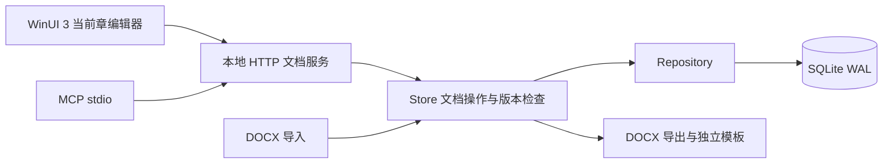

# 架构 v2

目标是稳定对象身份、局部读写和人类/Agent 协作。页面排版不参与内部内容模型。

## 模型与顺序

- Document：身份、标题、文档提交版本、告警和独立导出模板。没有重复全文。
- Section：身份、父章节、标题 Block ID、位置、子树版本。章节名称从标题块派生，层级从父子关系派生。
- Block：身份、类型、语义 JSON、版本、唯一归属章节与位置。Paragraph/Heading/Table/Image 是主要类型；保留列表、引用、代码块等已有语义作为扩展。
- 同一父节点下的 Block 与子 Section 共享位置轴。`entries` 按该位置轴读取；导出递归遍历这些条目，支持“父章块→子章→父章尾部块”。顶层章节同样有确定顺序。
- 浮点间隔排序通常只改移动对象。间隔耗尽时只整理相关父节点的条目，不处理全文。

## 写入热路径

`Store.apply → BEGIN IMMEDIATE → 检查对象版本 → 处理受影响行 → 递增必要祖先版本 → 记录变化 → COMMIT → 通知`。

正文不存在原始 XML、来源样式、Markdown 镜像或全项目对象缓存。单块修改校验、序列化及读写仅涉及该块、归属关系和必要祖先；表格是一个 Block，修改单元格仍提交该表格，这是明确的第一阶段边界。

数据库使用 WAL、`synchronous=FULL`、外键和事务；项目文件锁阻止第二个文档服务成为写入权威。提交失败整体回滚。进程中断后 SQLite 恢复未完成事务，异常退出的项目文件锁有约 30 秒失效窗口。

模型规范化在 `model.js`；数据库连接、行读写、事务和完整性检查在 `repository.js`，Store 接受 Repository 工厂。领域模型不引用 SQLite 类型；目前 Store 部分查询仍使用 SQL 接口，替换成非 SQL 持久化时需实现等效查询适配。

## 读取与同步

项目打开返回文档信息和章节摘要；当前章节通过 `read_section` 加载，已知块 ID 直接 `read_block`。

服务提供 SSE 和 `get_changes` 游标补齐。WinUI 使用轻量版本检查与增量拉取，空闲不序列化全文；指定当前 `section_id` 后其他章只返回摘要，跨节移动返回移出 ID。样式仅在样式变化时更新。

写入结果不推进客户端的接收游标，避免跳过保存前其他客户端已提交的独立变更。当前脏块遇到外部更新、删除或移动会保留输入并进入冲突状态。

## WinUI 编辑

沿用原生 RichEditBox、输入法组合事件、剪贴板和表格模型。普通修改只更新受影响的根块控件，标题或结构变化才更新导航。

撤销记录包含受影响块的前后内容及顺序变化；草稿保存脏块、基线版本和必要结构。新增块使用客户端临时 ID，提交后替换为服务端 UUID；恢复已删除块需要精确删除版本，恢复原 ID。

大表格单元格平时使用 TextBlock，只有活动单元格建立编辑器。布局使用坐标占用索引。当前尚未实现按视口回收所有阅读单元格控件，极大表格的首次布局仍有成本。

## 导入导出与兼容

导入只保留内容语义、逻辑表格与图片；复杂内容显式告警。导出生成标准 DOCX，身份标签只携带稳定 ID 和组织信息，不以隐藏旧正文覆盖用户在 Word 中修改的文字。

旧项目先备份并核验后启用 SQLite，旧文件停止参与正常编辑。旧 MCP 工具名和 `node`/Markdown 输入保留适配，返回值统一为局部变更包。Electron/Tiptap 和旧浏览器代码只留在本次回滚档案中。

SQLite API 依据：[Node 24 官方文档](https://nodejs.org/download/release/latest-v24.x/docs/api/sqlite.html)。本机实际运行版本为 Node 24.19.0。
